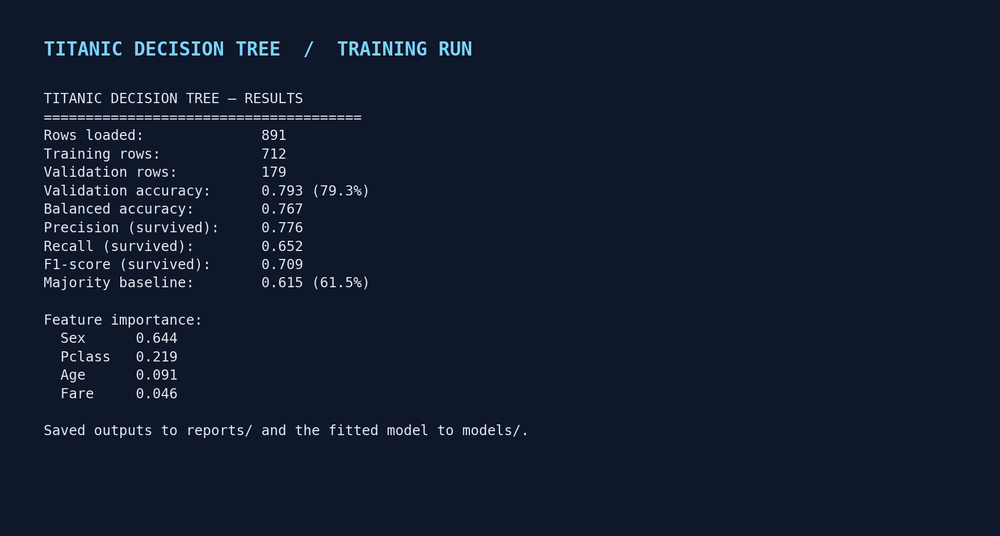

# Titanic Survival Prediction — Decision Tree Classifier

> A reproducible, beginner-friendly machine-learning project that predicts Titanic passenger survival from **passenger class, sex, age, and fare** using Pandas and scikit-learn. It includes data validation, missing-value handling, a held-out evaluation, feature-importance analysis, a readable tree visualisation, automated tests, and a small prediction CLI.


## Project at a glance

- **Problem:** predict `Survived` (`0` = did not survive, `1` = survived).
- **Data:** Kaggle Titanic competition's labelled `train.csv`.
- **Features:** `Pclass`, `Sex`, `Age`, `Fare`.
- **Algorithm:** `DecisionTreeClassifier` in a scikit-learn `Pipeline`.
- **Evaluation:** stratified 80/20 train/validation split with fixed random seed `42`.
- **Interpretability:** aggregated feature importance and a plotted decision tree.

### Latest included experiment

The included reports and images are example artifacts generated from a run on the standard 891-row Titanic training table. Once you download the official Kaggle file and run the commands below, the project regenerates them using your local file and current environment.

| Metric | Included run |
|---|---:|
| Validation accuracy | **79.3%** |
| Balanced accuracy | **76.7%** |
| Precision (survived class) | **77.6%** |
| Recall (survived class) | **65.2%** |
| F1-score (survived class) | **70.9%** |
| Majority-class baseline accuracy | **61.5%** |

The exact scores depend on the input CSV and model settings. Do not treat a single holdout score as a guarantee of real-world performance.

## Results and visuals

### 1. Dataset overview


### 2. Feature importance


Importance is aggregated back to the four original inputs, so the two one-hot encoded `Sex` categories are reported together. It describes how the fitted tree used the features; it does **not** establish causation.

### 3. Validation performance


Read the confusion matrix together with precision and recall in [`reports/classification_report.txt`](reports/classification_report.txt). Accuracy alone can conceal which class the model struggles to identify.

### 4. Training output



### 5. The trained tree


The tree is intentionally limited to depth 3 and a minimum of 8 samples per leaf. This makes it easier to inspect and helps reduce overfitting compared with an unrestricted tree.

## Quick start

### 1. Requirements

Use Python 3.10 or newer. From the repository root, create and activate a virtual environment.

**macOS / Linux**

```bash
python3 -m venv .venv
source .venv/bin/activate
python -m pip install --upgrade pip
python -m pip install -r requirements.txt
```

**Windows PowerShell**

```powershell
py -m venv .venv
.venv\Scripts\Activate.ps1
python -m pip install --upgrade pip
python -m pip install -r requirements.txt
```

### 2. Download the dataset

Follow [`data/README.md`](data/README.md) to download `train.csv` from Kaggle and put it at `data/train.csv`. The raw CSV is ignored by Git so it is not accidentally committed.

### 3. Train and evaluate

Run from the repository root:

```bash
PYTHONPATH=src python -m titanic_tree.train
```

On Windows PowerShell, use:

```powershell
$env:PYTHONPATH = "src"
python -m titanic_tree.train
```

The command prints metrics and writes:

- `reports/metrics.json` — machine-readable results and run configuration
- `reports/SUMMARY.md` — generated plain-English experiment summary
- `reports/classification_report.txt` — precision, recall, and F1 by class
- `reports/feature_importance.csv` — original-feature importances
- `reports/validation_predictions.csv` — actual vs. predicted labels for the validation split
- `reports/figures/` — dataset overview, feature-importance chart, confusion matrix, and tree diagram
- `models/decision_tree_pipeline.joblib` — fitted preprocessing + model pipeline (local generated file)

Change the tree depth or leaf size for a small experiment:

```bash
PYTHONPATH=src python -m titanic_tree.train --max-depth 4 --min-samples-leaf 12
```

### 4. Make a sample prediction

After training, try a passenger profile:

```bash
PYTHONPATH=src python -m titanic_tree.predict --sex female --age 25 --pclass 1 --fare 80
```

The predicted class and model-estimated probability are printed. This is an educational model output, not historical certainty about an individual passenger.

### 5. Run the tests

```bash
PYTHONPATH=src pytest -q
```

In PowerShell, set `$env:PYTHONPATH = "src"` first. Tests use a small synthetic fixture and do not require the Kaggle file.

## How the pipeline works

1. **Load & validate:** Pandas reads `train.csv`; required columns and binary target values are checked.
2. **Select target and features:** `Survived` is the label; `Pclass`, `Age`, `Fare`, and `Sex` are inputs.
3. **Split before fitting preprocessing:** stratified train/validation split preserves the survival-class ratio. The random seed makes the split reproducible.
4. **Impute missing values:** median imputation is used for numeric inputs (`Age`, with `Pclass` and `Fare` included in the same numeric transformer); most-frequent imputation is used for `Sex`.
5. **Encode categories:** one-hot encoding converts `Sex` to numeric indicator columns. Unknown categories are handled without crashing.
6. **Train:** a decision tree uses Gini impurity, maximum depth 3, minimum leaf size 8, and random seed 42.
7. **Evaluate:** accuracy, balanced accuracy, survival-class precision/recall/F1, the majority-class baseline, and a confusion matrix are reported on held-out rows.
8. **Interpret:** encoded `Sex` importances are aggregated to the original `Sex` feature, then all four input importances are plotted.

All preprocessing lives inside the scikit-learn `Pipeline`, which means imputation/encoding parameters are fitted on the training split only and then applied to validation data.

## Notebook and submission report

- [Step-by-step Jupyter notebook](notebooks/titanic_decision_tree.ipynb) — data inspection, missing values, model fitting, metrics, plots, and findings.
- [Project report (DOCX)](docs/Titanic_Decision_Tree_Project_Report.docx) — formatted report with the actual run metrics and figures; upload it to Google Drive and open it in Google Docs to create the shareable report.
- [Project report (Markdown)](docs/PROJECT_REPORT.md) — source version of the report.
- [Submission checklist](docs/SUBMISSION_CHECKLIST.md) — steps for publishing the code and sharing the report.
- [Reviewer / viva preparation](docs/VIVA_PREP.md) — common technical questions and the reasoning behind the design choices.

To run the notebook locally, install its optional dependencies with `python -m pip install -e ".[dev]"`, then open `notebooks/titanic_decision_tree.ipynb` in Jupyter.

The project includes a small GitHub Actions workflow that runs the automated tests on pushes and pull requests.

## Project structure

```text
.
├── data/
│   └── README.md
├── models/                         # fitted model created locally
├── notebooks/
│   └── titanic_decision_tree.ipynb  # step-by-step notebook
├── reports/
│   ├── SUMMARY.md
│   ├── metrics.json
│   ├── classification_report.txt
│   ├── feature_importance.csv
│   └── figures/
├── src/titanic_tree/
│   ├── model.py                    # loading, pipeline, metrics, plots
│   ├── train.py                    # command-line training entry point
│   └── predict.py                  # single-passenger prediction CLI
├── tests/test_model.py
├── requirements.txt
└── pyproject.toml
```

## Limitations and responsible interpretation

- This is a teaching project using a small historical dataset, not a model suitable for safety-critical decisions.
- A held-out split measures performance on one sample; repeated validation or cross-validation would give a more stable estimate.
- Feature importance is model-specific and can change if the train/validation split or tree parameters change.
- Associations in this dataset are not proof that a feature caused survival or non-survival.
- The model only uses four selected fields. It deliberately omits potentially informative details such as family relationships, cabin, and embarkation port to keep the project aligned with the assignment.
- The Kaggle test file has no survival labels, so it is not used for local accuracy calculation.

## Dataset and references

- [Kaggle: Titanic — Machine Learning from Disaster (data and data dictionary)](https://www.kaggle.com/competitions/titanic/data)
- [scikit-learn: DecisionTreeClassifier](https://scikit-learn.org/stable/modules/generated/sklearn.tree.DecisionTreeClassifier.html)
- [scikit-learn: Pipeline and composite estimators](https://scikit-learn.org/stable/modules/compose.html)
- [scikit-learn: Model evaluation](https://scikit-learn.org/stable/modules/model_evaluation.html)

The source competition data is governed by Kaggle's competition rules. Download the dataset from Kaggle and follow the rules shown there.

## Author notes for submission

Before submitting, replace any personal author placeholder you choose to add, make sure the code and report you present are understood by you, and push the final project to a **public** GitHub repository. The generated report can be uploaded to Google Drive and opened with Google Docs; set the document's general access to **Anyone with the link — Viewer** if that is what your assignment requires.
