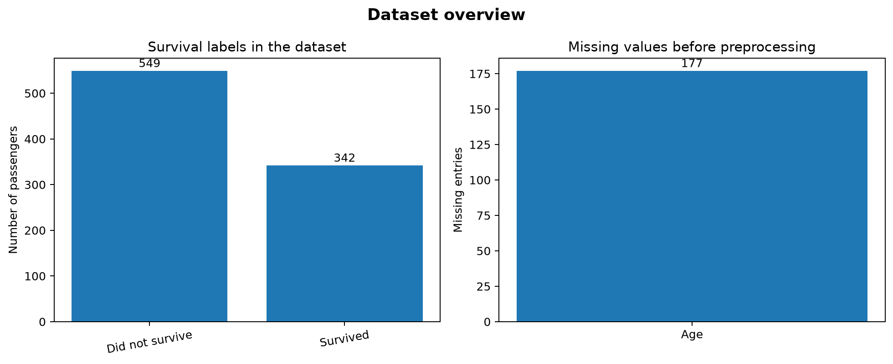
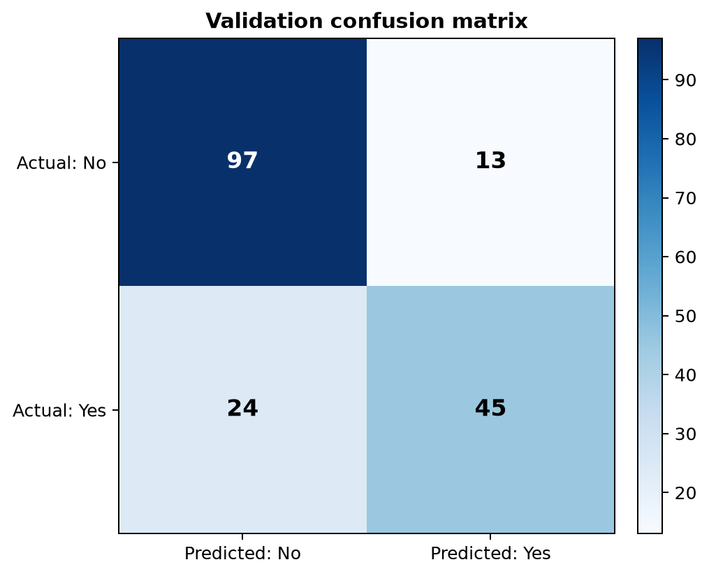
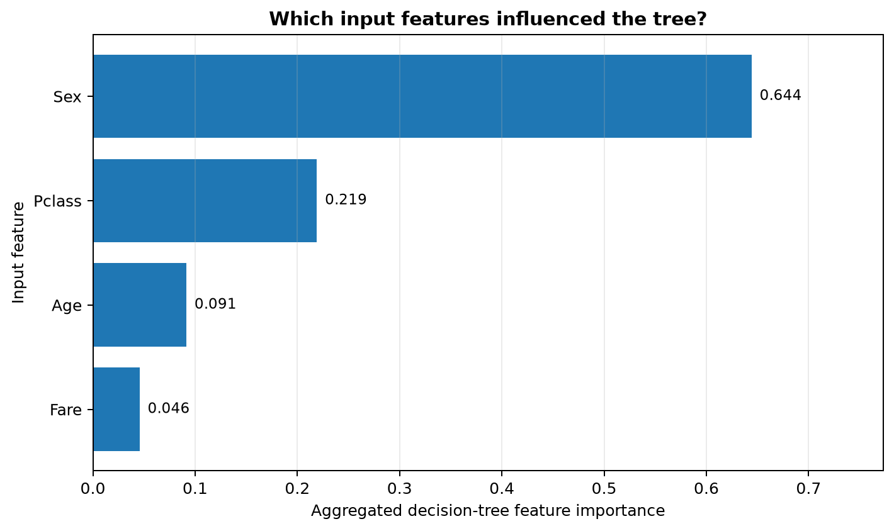
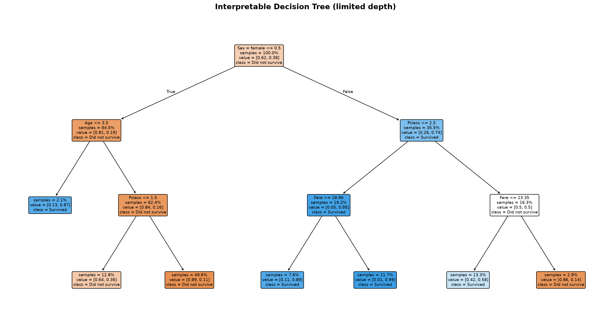

# Titanic Survival Prediction — Project Report

**Prepared by:** [Your Name]  
**Tools:** Python, Pandas, scikit-learn, Matplotlib  
**Algorithm:** Decision Tree Classifier  
**Dataset:** Kaggle Titanic — Machine Learning from Disaster

## 1. Objective

The objective is to build a machine-learning model that predicts whether a passenger survived the Titanic disaster. `Survived` is the target variable: `0` means did not survive and `1` means survived.

## 2. Dataset and feature selection

The project uses the labelled `train.csv` file from the Kaggle Titanic competition. It contains 891 passenger rows in the standard dataset. The selected input features are:

| Feature | Description |
|---|---|
| `Pclass` | Passenger ticket class (1, 2, or 3) |
| `Sex` | Passenger sex; encoded into numeric indicator columns |
| `Age` | Passenger age in years |
| `Fare` | Passenger fare |

The target column is `Survived`. The Kaggle test file does not provide target labels, so it is not used to calculate validation accuracy.

## 3. Data exploration and cleaning

Pandas is used to load the CSV, inspect its shape and data types, check target counts, and identify missing values. In the included run, 177 values are missing from `Age`. Numeric missing values are filled using the median, while categorical values are filled using the most frequent category. `Sex` is one-hot encoded so scikit-learn can use it. These transformations are stored inside the pipeline and are fitted only on training rows.

## 4. Model training

A stratified 80/20 split is created with `random_state=42`. The training portion has 712 rows and the validation portion has 179 rows. The model is a `DecisionTreeClassifier` using Gini impurity, `max_depth=3`, and `min_samples_leaf=8`. The shallow tree is intended to keep the model understandable and reduce overfitting compared with an unrestricted tree.

## 5. Evaluation

The included run produced these results on the held-out validation split:

| Metric | Result |
|---|---:|
| Accuracy | 79.3% |
| Balanced accuracy | 76.7% |
| Precision for the survival class | 77.6% |
| Recall for the survival class | 65.2% |
| F1-score for the survival class | 70.9% |
| Majority-class baseline accuracy | 61.5% |

Accuracy is the share of validation rows classified correctly. The baseline compares the model with a simple rule that predicts the most common class for every passenger. The model is better than that baseline in this run, but it still makes mistakes.

The confusion matrix has 97 true negatives, 13 false positives, 24 false negatives, and 45 true positives. In particular, 24 passengers who survived were incorrectly classified as non-survivors, so accuracy should be considered together with recall and F1-score.

## 6. Feature importance and findings

The tree's one-hot-encoded `Sex` importances are aggregated back into the single original feature so the graph compares the four features named in the assignment.

| Rank | Feature | Importance |
|---:|---|---:|
| 1 | Sex | 0.644 (64.4%) |
| 2 | Pclass | 0.219 (21.9%) |
| 3 | Age | 0.091 (9.1%) |
| 4 | Fare | 0.046 (4.6%) |

For this fitted tree, `Sex` is the most influential input, followed by passenger class. Feature importance is model-specific and reflects how the tree uses each input to split the data; it does not prove that a feature caused the outcome.

## 7. Steps to run the project

1. Download `train.csv` from [the Kaggle data page](https://www.kaggle.com/competitions/titanic/data) and place it at `data/train.csv`.
2. Install Python 3.10+ and run `python -m pip install -r requirements.txt`.
3. From the project root, run `PYTHONPATH=src python -m titanic_tree.train`. For Windows PowerShell, first run `$env:PYTHONPATH = "src"`.
4. Review `reports/metrics.json`, `reports/SUMMARY.md`, `reports/classification_report.txt`, and the images in `reports/figures/`.
5. Run automated checks using `PYTHONPATH=src pytest -q`.

## 8. Limitations

- This is a small educational dataset, not a safety-critical model.
- The reported result is from one held-out split and may change with a different split or model setting.
- Only four features are used, as requested by the assignment; other passenger information could change performance.
- Feature importance describes model behaviour and does not prove causation.

## References

- [Kaggle: Titanic — Machine Learning from Disaster](https://www.kaggle.com/competitions/titanic/data)
- [scikit-learn: DecisionTreeClassifier](https://scikit-learn.org/stable/modules/generated/sklearn.tree.DecisionTreeClassifier.html)
- [scikit-learn: Pipeline and composite estimators](https://scikit-learn.org/stable/modules/compose.html)
